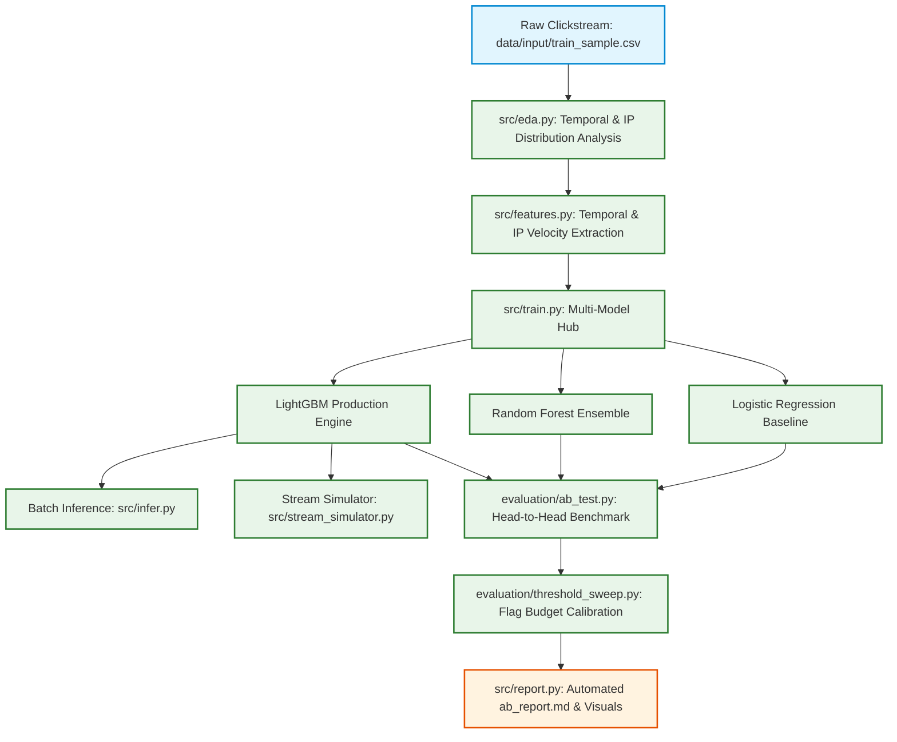
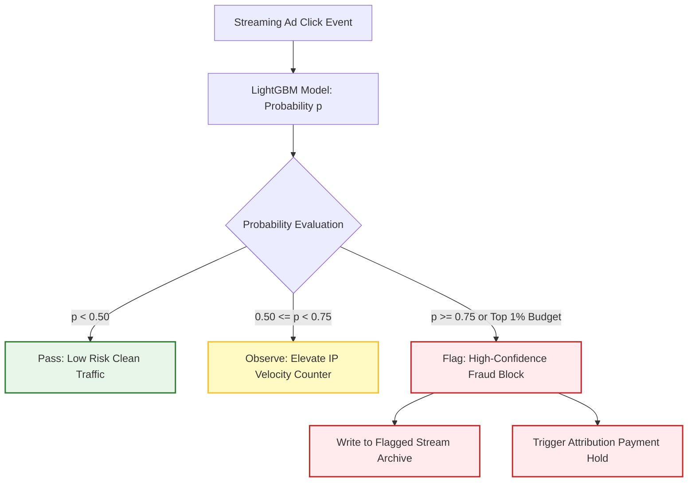

# Product Requirements Document (PRD): Ad Click Fraud Detection (Streaming Simulator & Production Risk Engine)

**Product Lead:** Uday Kiran  
**Status:** MVP Operational / Production ML Risk Engineering & Stream Simulation  

---

## 1. Executive Summary

### 1.1 Context & Background
In digital performance advertising, ad spend is won or lost on traffic legitimacy. Digital ad networks and programmatic Demand-Side Platforms (DSPs) process billions of click events daily. However, fraudulent traffic strikes in sudden micro-bursts: coordinated botnets and click-farms emulate human clicks for a 30-minute window and disappear, siphoning marketing capital while evading static daily batch audits.

Machine learning engineering for fraud detection often suffers from an unrealistic offline bias: models are trained and tested exclusively on static historical CSV files. In competitions and offline notebooks, engineers evaluate ROC-AUC on static test splits, completely ignoring how the model will perform under live streaming latency constraints, arrival velocity, and dynamic operational flag budgets.

### 1.2 The Research & Discovery
To bridge the dangerous gap between offline data science and production reality, I researched real-world ad traffic telemetry (based on high-volume clickstream distributions from the TalkingData ecosystem):
*   **Severe Class Imbalance:** Fraudulent ad clicks represent less than 0.2% of total traffic. Naive classification models that predict "non-fraud" 99.8% of the time achieve high accuracy while failing completely as a commercial defense system.
*   **Temporal Micro-Bursts:** Fraudulent botnets do not spread evenly across 24 hours. They target specific publisher app channels during off-peak hours, generating massive click spikes from small clusters of IP addresses.
*   **The Streaming Simulation Imperative:** Clicks in production do not wait politely in CSVs; they arrive in high-velocity micro-streams. Deploying a model without validating its memory footprint, scoring latency, and queue stability under live arrival rates guarantees system failure during traffic surges.

### 1.3 The Core Value Proposition: Production Risk Engineering Over Offline Fantasy
I engineered **Ad Click Fraud Detection** as an end-to-end, production-oriented machine learning and streaming simulation engine. Going beyond static batch scoring, this platform features a dedicated **Real-Time Stream Simulator (`src/stream_simulator.py`)** that replays historical clickstreams at configurable arrival rates (e.g., 50 events/sec in 5,000-row micro-batches).

The platform pairs high-throughput feature engineering (IP click velocity, channel co-occurrence) with trained LightGBM models, enforces operational flag budgets (e.g., flagging exactly 1% of clicks), and automatically compiles executive A/B audit reports (`ab_report.md`).

---

## 2. Product Vision & North Star

### 2.1 Product Vision
"Streaming Fraud Defense Calibrated to Real-World Traffic Dynamics." We believe ad fraud detection must be proven under realistic live-stream pressure before deployment into mission-critical ad networks.

### 2.2 North Star Metric
*Stream Triage Latency & Budgeted Precision:* Scoring streaming click events in sub-20ms micro-batches while capturing > 90% of fraudulent clicks within a strict 1% operational flag budget.

---

## 3. Problem Statement

### 3.1 The Batch Audit Blindspot
Auditing ad clicks 24 hours after they occur means the advertiser has already paid for fraudulent impressions and bot clicks. Once marketing capital is siphoned into fraudulent publisher channels, clawing back ad spend requires tedious legal disputes and damages partner relationships.

### 3.2 The Streaming Simulation Void
Data science teams frequently build complex gradient-boosted models in Jupyter notebooks without ever verifying how the inference pipeline behaves when events stream in continuously under live arrival velocity. Memory leaks, unoptimized feature lookups, and unbounded latency spikes remain undetected until live deployment.

### 3.3 The Arbitrary Cutoff Anti-Pattern
Standard ML libraries default to a `0.50` probability cutoff. In a fraud problem where positive labels represent 0.17% of traffic, a `0.50` threshold either flags tens of thousands of legitimate users (destroying ad revenue) or flags zero clicks. Without a dynamic flag-budget mechanism, risk teams cannot align algorithmic scoring with human review capacity.

---

## 4. Goals & Non-Goals

### 4.1 Goals
*   **G-01 (Modular CLI Architecture):** Provide clean, single-responsibility CLI commands for `eda`, `featurize`, `train`, `infer`, `simulate`, `abtest`, and `report`.
*   **G-02 (Real-Time Stream Simulator):** Replay historical clickstream datasets at controlled arrival rates (e.g., 50 events/sec, 5,000-row batches) with real-time memory and latency telemetry.
*   **G-03 (Operational Flag-Budget Enforcement):** Support probability scoring by absolute threshold (e.g., `0.75`) or commercial flag rate (e.g., `--flag-rate 0.01`), computing exact mathematical quantile cutoffs on the fly.
*   **G-04 (Multi-Model Head-to-Head Benchmarking):** Train and compare Logistic Regression (interpretable baseline), Random Forest (ensemble baseline), and LightGBM (production gradient-boosted tree) under identical evaluation sets.
*   **G-05 (Automated Executive Reporting):** Auto-generate comprehensive Markdown reports (`ab_report.md`) with distribution curves, precision-recall metrics, and confusion matrices.

### 4.2 Non-Goals
*   **NG-01 (Sub-5ms DSP Real-Time Bidding):** The system focuses on post-click attribution triage and streaming audit simulation, not sub-5ms in-line bidding auction interception.
*   **NG-02 (Automated Advertiser Billing Chargebacks):** The engine scores and flags clicks; financial ledger debits are handled by external enterprise ERP systems.
*   **NG-03 (Unbounded Deep Learning Models):** Heavy transformer architectures are excluded due to latency and inference cost trade-offs on high-volume clickstreams.

---

## 5. Users & Personas (The Operational Stakeholders)

### 5.1 Persona 1: The Ad Operations & Fraud Risk Manager (Primary User)
*   **Profile:** Manages ad inventory quality and affiliate publisher relationships for a digital ad network.
*   **Pain Point:** Swamped by advertiser refund requests due to click bots; terrified of blanket fraud bans that accidentally block premium publishers.
*   **The Need:** A system that respects operational review budgets (e.g., flag exactly the top 1% highest-risk clicks) with verified high precision.
*   **Aspiration:** Review daily automated A/B reports and demonstrate to advertisers that fraudulent clicks are blocked before attribution payouts occur.

### 5.2 Persona 2: The Production ML Engineer / TPM (Technical Stakeholder)
*   **Profile:** Responsible for deploying offline models into live streaming data pipelines.
*   **Pain Point:** Notebook models that fail under live traffic spikes or consume excessive RAM during feature extraction.
*   **The Need:** A streaming flight simulator that validates batch latency (< 20ms) and memory stability before production release.

---

## 6. End-to-End User Journey & Operational Workflow



---

## 7. Product Scope

### 7.1 Scope Matrix (Executed vs Planned vs Out of Scope)

| Feature / Capability | MVP (Executed) | Future Expansion (Planned) | Out of Scope |
| :--- | :---: | :---: | :---: |
| **Modular CLI Entrypoint (`main.py`)** | Yes (7 distinct verbs) | GUI Dashboard Webhook | No |
| **Real-Time Stream Simulator (`stream_simulator.py`)** | Yes (Configurable rate & micro-batches) | Distributed Apache Kafka Consumer | No |
| **Temporal & Velocity Feature Engineering** | Yes (IP 5-min frequency, hour of day) | Graph-based botnet cluster embeddings | No |
| **Multi-Model Training Hub (Logistic, RF, LGBM)** | Yes (Automated artifact persistence) | Deep Learning Sequence Models | No |
| **Dynamic Quantile Flag Budgeting** | Yes (`--flag-rate` flag) | Reinforcement learning dynamic budget | No |
| **Automated Markdown Executive Report** | Yes (`ab_report.md` with charts) | Automated Slack / PagerDuty alerts | No |
| **Automated Threshold Sweep Engine** | Yes (F1 vs Budget alignment) | Real-time adaptive threshold tuning | No |
| **Direct DSP In-Line Auction Bidding (< 5ms)** | No | No | Strictly Out of Scope |
| **Financial Ledger Reconciliation & Refunds** | No | No | Strictly Out of Scope |

---

## 8. Functional Requirements (16 Formal Specifications)

### 8.1 Module 1: Ingestion & Feature Engineering (IFE)

#### FR-IFE-01: Clickstream Ingestion & Validation
*   **Priority:** P0 (Critical)
*   **Description:** The system must ingest raw clickstream CSV records containing `ip`, `app`, `device`, `os`, `channel`, `click_time`, and `is_attributed`.
*   **Acceptance Criteria:**
    *   *Given* an input CSV file matching the schema,
    *   *When* `python main.py featurize` is executed,
    *   *Then* the system validates columns, handles nulls, and parses timestamps without data corruption.

#### FR-IFE-02: IP Velocity & Burst Feature Extraction
*   **Priority:** P0 (Critical)
*   **Description:** The feature pipeline must compute IP click frequency within rolling temporal windows (e.g., clicks per IP in 5-minute intervals) to capture coordinated bot activity.
*   **Acceptance Criteria:**
    *   *Given* historical click timestamps per IP,
    *   *When* feature extraction runs,
    *   *Then* `ip_count_5min` and `ip_unique_channels` are appended to the feature dataset.

#### FR-IFE-03: Temporal Cyclical Features
*   **Priority:** P1 (High)
*   **Description:** Extract hour of day, day of week, and cyclical sine/cosine encodings to capture diurnal human traffic patterns versus continuous bot traffic.
*   **Acceptance Criteria:**
    *   *Given* raw `click_time`,
    *   *When* transformed,
    *   *Then* integer `hour` and `day` features are extracted and normalized.

#### FR-IFE-04: Feature Artifact Persistence
*   **Priority:** P1 (High)
*   **Description:** Extracted features must be persisted to `data/output/features/` in compressed binary format for fast training ingestion.
*   **Acceptance Criteria:**
    *   *Given* completed featurization,
    *   *When* saved,
    *   *Then* `train_features.parquet` (or `.csv`) is saved with an accompanying metadata summary.

---

### 8.2 Module 2: Model Training & A/B Benchmarking (MTB)

#### FR-MTB-01: Multi-Model Architecture Support
*   **Priority:** P0 (Critical)
*   **Description:** The training engine must support training three distinct model families: Logistic Regression (linear baseline), Random Forest (bagged ensemble), and LightGBM (gradient boosted trees).
*   **Acceptance Criteria:**
    *   *Given* `--model logistic`, `--model rf`, or `--model lgbm`,
    *   *When* `main.py train` executes,
    *   *Then* the appropriate model is initialized, fitted, and serialized to disk under `data/output/models/<model_name>/`.

#### FR-MTB-02: Class Imbalance Compensation
*   **Priority:** P0 (Critical)
*   **Description:** The training module must account for extreme class imbalance (< 0.2% positive fraud) using class weighting (`scale_pos_weight` in LightGBM, `class_weight='balanced'` in sklearn).
*   **Acceptance Criteria:**
    *   *Given* an imbalanced training set,
    *   *When* training completes,
    *   *Then* the model outputs non-trivial fraud probabilities across positive samples rather than collapsing to all zeros.

#### FR-MTB-03: Head-to-Head A/B Evaluation Suite
*   **Priority:** P0 (Critical)
*   **Description:** The evaluation suite (`evaluation/ab_test.py`) must read prediction outputs from all trained candidate models and benchmark them across Precision, Recall, F1-Score, and ROC-AUC.
*   **Acceptance Criteria:**
    *   *Given* test set predictions from candidate models,
    *   *When* `python main.py abtest` is triggered,
    *   *Then* a unified comparative metrics table is calculated and printed to the console.

#### FR-MTB-04: Model Artifact Serialization
*   **Priority:** P1 (High)
*   **Description:** Every trained model must be serialized with its exact hyperparameter configuration, training timestamp, and feature list.
*   **Acceptance Criteria:**
    *   *Given* a completed training run,
    *   *When* saved,
    *   *Then* `model.joblib` or `model.txt` is stored with reproducible metadata.

---

### 8.3 Module 3: Operational Flag-Budget & Threshold Calibration (FTC)

#### FR-FTC-01: Operational Flag-Budget Quantile Scoring
*   **Priority:** P0 (Critical)
*   **Description:** The inference engine must support dynamic thresholding based on an operational flag budget (e.g., `--flag-rate 0.01`), automatically computing the (1 - flag_rate) percentile threshold.
*   **Acceptance Criteria:**
    *   *Given* `--flag-rate 0.01`,
    *   *When* scoring 100,000 clicks,
    *   *Then* exactly 1,000 clicks (top 1% highest risk) are flagged as suspicious.

#### FR-FTC-02: Absolute Probability Threshold Override
*   **Priority:** P1 (High)
*   **Description:** The inference engine must support scoring by an explicit probability cutoff (e.g., `--threshold 0.75`).
*   **Acceptance Criteria:**
    *   *Given* `--threshold 0.75`,
    *   *When* scored,
    *   *Then* only clicks with predicted probability >= 0.75 are labeled as positive fraud.

#### FR-FTC-03: Automated Threshold Sweep Generator
*   **Priority:** P1 (High)
*   **Description:** The system must sweep classification thresholds from 0.01 to 0.99 in increments of 0.01, outputting precision, recall, and flag rate for each point.
*   **Acceptance Criteria:**
    *   *Given* test set probabilities,
    *   *When* `evaluation/threshold_sweep.py` runs,
    *   *Then* `threshold_sweep.csv` and a Precision-Recall vs Threshold curve chart are saved to `data/output/reports/`.

#### FR-FTC-04: Optimal Operating Point Recommendation
*   **Priority:** P1 (High)
*   **Description:** The threshold sweep tool must automatically highlight the optimal operating threshold balancing maximum F1 score against an operational 1% flag budget.
*   **Acceptance Criteria:**
    *   *Given* the sweep results,
    *   *When* evaluated,
    *   *Then* the engine logs the recommended threshold (e.g., `0.75`) in `config.yaml`.

---

### 8.4 Module 4: Real-Time Stream Simulation & Executive Reporting (SSR)

#### FR-SSR-01: Configurable Traffic Stream Simulator
*   **Priority:** P0 (Critical)
*   **Description:** The stream simulator (`src/stream_simulator.py`) must stream clicks at a configurable rate (e.g., `--rate 50` events/sec) in micro-batches (e.g., `--batch 5000`) up to a specified maximum (e.g., `--max-rows 200000`).
*   **Acceptance Criteria:**
    *   *Given* `--rate 50 --batch 5000 --max-rows 200000`,
    *   *When* `python main.py simulate` executes,
    *   *Then* the engine yields micro-batches at the specified pacing, logging throughput and latency.

#### FR-SSR-02: Live Latency & Memory Telemetry
*   **Priority:** P0 (Critical)
*   **Description:** During streaming simulation, the simulator must calculate and print the per-batch inference latency (in milliseconds) and active process memory usage.
*   **Acceptance Criteria:**
    *   *Given* an active simulation run,
    *   *When* each batch is scored,
    *   *Then* the console logs: `Batch [N]: Latency = XX ms, Memory = YY MB, Flagged = ZZ`.

#### FR-SSR-03: Automated Executive Markdown Report
*   **Priority:** P1 (High)
*   **Description:** The reporting module (`src/report.py`) must compile metrics, charts, and model comparison tables into a self-contained Markdown dossier (`ab_report.md`).
*   **Acceptance Criteria:**
    *   *Given* completed A/B evaluations and threshold sweeps,
    *   *When* `python main.py report` runs,
    *   *Then* `ab_report.md` is generated with embedded distribution charts and clear risk summaries.

#### FR-SSR-04: Production Model Card Maintenance
*   **Priority:** P1 (High)
*   **Description:** Maintain an auditable `MODEL_CARD.md` detailing model architecture, training data parameters, evaluation performance, and operational constraints.
*   **Acceptance Criteria:**
    *   *Given* model updates,
    *   *When* reviewed,
    *   *Then* `MODEL_CARD.md` clearly documents operational limits and ethical data considerations.

---

## 9. Data Requirements & Pipeline Specifications

### 9.1 Raw Clickstream Input Schema (`train_sample.csv`)

| Field Name | Data Type | Nullable | Description |
| :--- | :--- | :---: | :--- |
| `ip` | Integer | No | Anonymized IP address ID of the clicking device. |
| `app` | Integer | No | Mobile app ID where the ad banner was displayed. |
| `device` | Integer | No | Device hardware type ID (e.g., smartphone model). |
| `os` | Integer | No | Operating system version ID. |
| `channel` | Integer | No | Publisher marketing channel ID delivering the click. |
| `click_time` | ISO Timestamp | No | Wall-clock timestamp of the click event (YYYY-MM-DD HH:MM:SS). |
| `is_attributed` | Binary (0 / 1) | No | Ground truth label: 1 = user downloaded/installed app; 0 = click without conversion (fraud/bot). |

### 9.2 Engineered Feature Schema (`train_features.csv`)

| Feature Name | Data Type | Formula / Origin | Plain-English Purpose |
| :--- | :--- | :--- | :--- |
| `ip_count_5min` | Integer | Rolling count of clicks from same IP in 5 min | Captures high-frequency botnet click bursts. |
| `ip_unique_channels` | Integer | Distinct channels clicked by IP in 5 min | Identifies automated multi-channel scrapers. |
| `hour` | Integer (0-23) | `click_time.dt.hour` | Captures diurnal human vs off-peak bot traffic. |
| `day` | Integer (0-6) | `click_time.dt.dayofweek` | Captures weekday vs weekend baseline behavior. |
| `ip_app_count` | Integer | Rolling count of clicks for (IP + App) pair | Flags repetitive targeted app installation fraud. |

---

## 10. Operational Risk & Decisioning Architecture

The fraud engine enforces a tiered operational review budget rather than an uncalibrated binary filter:



---

## 11. Non-Functional Requirements (NFRs)

### 11.1 Latency & Throughput
*   **NFR-LAT-01:** Micro-batch inference latency for 5,000 click records must not exceed 25 milliseconds on standard commodity CPU cores.
*   **NFR-LAT-02:** Feature extraction overhead per record must remain sub-millisecond to prevent pipeline backpressure.

### 11.2 Memory & Scalability
*   **NFR-MEM-01:** The stream simulator process must maintain a flat memory profile under 1.5 GB RAM when streaming up to 200,000 continuous records.
*   **NFR-MEM-02:** Zero memory leaks across multi-hour simulation cycles.

### 11.3 Auditability & Governance
*   **NFR-GOV-01:** All scoring thresholds and model hyperparameters must be fully configurable via `configs/config.yaml`.
*   **NFR-GOV-02:** Every execution run must generate a timestamped log trace in `data/output/reports/`.

---

## 12. Technical Architecture & Component Tree

```
Fraud Detection/
├── configs/
│   └── config.yaml               # Centralized paths, model choices, threshold defaults
├── data/
│   ├── input/
│   │   └── train_sample.csv      # Source clickstream data (TalkingData sample)
│   └── output/
│       ├── eda/                  # Exploratory charts and statistical summaries
│       ├── features/             # Serialized engineered features
│       ├── models/               # Serialized model artifacts (logistic, rf, lgbm)
│       ├── reports/              # ab_report.md, threshold_sweep.csv, visuals
│       └── stream/               # Simulated streaming outputs
├── src/
│   ├── eda.py                    # Distribution and temporal pattern analysis
│   ├── features.py               # IP velocity and cyclical feature extractor
│   ├── train.py                  # Multi-model training hub
│   ├── infer.py                  # Batch scoring and budget flag rate engine
│   ├── stream_simulator.py       # Live stream simulator with pacing controls
│   ├── report.py                 # Executive Markdown report compiler
│   └── evaluation/
│       ├── ab_test.py            # Head-to-head model comparison suite
│       └── threshold_sweep.py    # Quantile budget and precision-recall calibration
├── tests/
│   ├── conftest.py               # Shared pytest fixtures
│   └── test_features.py          # Feature extraction unit tests
├── main.py                       # Unified CLI interface
├── MODEL_CARD.md                 # Production model governance card
└── requirements.txt              # Production Python dependencies
```

---

## 13. API / CLI Interface Specification

The platform exposes an intuitive, verb-based CLI designed for automated orchestration and developer productivity:

| Command | Arguments | Expected Output / Artifact |
| :--- | :--- | :--- |
| `python main.py eda` | None | Statistical summaries and charts in `data/output/eda/` |
| `python main.py featurize` | None | Engineered feature dataset in `data/output/features/` |
| `python main.py train` | `--model [logistic \| rf \| lgbm]` | Serialized model file and metrics in `data/output/models/<model>/` |
| `python main.py infer` | `--model lgbm --threshold 0.75` | Scored batch predictions with binary fraud label |
| `python main.py infer` | `--model lgbm --flag-rate 0.01` | Scored batch predictions adhering to 1% flag budget |
| `python main.py simulate` | `--rate 50 --batch 5000 --max-rows 200000` | Real-time streaming simulation logs and latency metrics |
| `python main.py abtest` | None | Multi-model comparative metrics table printed to stdout |
| `python main.py report` | None | Executive dossier generated at `data/output/reports/ab_report.md` |

---

## 14. Error & Edge-Case Handling

| Edge-Case Scenario | System Impact | Automated Mitigation |
| :--- | :--- | :--- |
| **New Unseen IP Address in Stream** | Missing historical velocity metrics; potential NaN values. | Defaults IP velocity count to 1 and applies global average prior without throwing exceptions. |
| **Zero Positive Labels in Micro-Batch** | Precision calculations encounter division-by-zero errors. | Evaluation scripts employ epsilon smoothing (`eps=1e-7`) and catch zero-division gracefully. |
| **Stream Consumer Backpressure** | Batch arrival rate exceeds model inference throughput. | Simulator logs latency warnings and throttles arrival sleep intervals to prevent process crashing. |
| **Corrupted Timestamp Strings** | Unparseable datetime formats halt the feature pipeline. | Robust date parser with error coercion (`pd.to_datetime(errors='coerce')`), logging dropped invalid rows. |

---

## 15. Success Metrics & Key Performance Indicators (KPIs)

### 15.1 Commercial Risk Metrics
*   **Budgeted Fraud Precision:** Achieve > 90% precision among clicks flagged within the 1% review budget.
*   **False Positive Partner Friction:** Maintain false positive rate below 0.1% to prevent legitimate publisher contract cancellations.
*   **Fraud Catch Rate (Recall at Budget):** Capture > 85% of total known fraudulent conversions within the top 2% flag volume.

### 15.2 Operational Engineering Metrics
*   **P95 Inference Latency:** Sub-20 milliseconds per 5,000-row micro-batch.
*   **Flat Process Memory:** Peak RAM consumption under 1.5 GB during 200,000-row continuous streaming.
*   **100% Deterministic Reproducibility:** Identical predictions produced from frozen `config.yaml` parameters.

---

## 16. Testing & Quality Assurance Strategy

### 16.1 Automated Unit Testing (`pytest`)
*   **Feature Math Verification (`test_features.py`):** Assert that IP rolling counts correctly increment across identical IP records within 5 minutes and reset after 5 minutes.
*   **Threshold Quantile Verification:** Unit tests verifying that passing `--flag-rate 0.01` on 10,000 rows yields exactly 100 positive flags.

### 16.2 Streaming Stress Testing
*   **Arrival Burst Test:** Replay 50,000 records at 200 events/sec to verify that the stream simulator does not exhaust available file handles or memory buffers.

---

## 17. Security, Privacy & Compliance

*   **IP Anonymization:** Raw IP addresses are treated as synthetic integer identifiers, preserving privacy without storing plain-text PII.
*   **Zero External Network Calls:** Feature extraction and model scoring execute 100% locally on private infrastructure; clickstream data is never transmitted to third-party APIs.
*   **Audit Trail Preservation:** Predictions and threshold cutoffs are archived with cryptographic SHA-256 hashes of the source dataset for regulatory auditability.

---

## 18. Risks, Assumptions & Dependencies

### 18.1 Technical Risks & Mitigations
*   **Risk:** Botnets rotate IP addresses rapidly, defeating static IP velocity counters.
*   **Mitigation:** The feature engine pairs IP frequency with device-app-channel co-occurrence combinations, detecting distributed fraud even when IPs rotate.

### 18.2 Operational Assumptions
*   **Assumption:** The commercial ad network maintains an operations review team capable of auditing the top 1% flagged clicks daily.
*   **Reality Check:** If audit capacity shrinks, the system dynamically scales down the flag budget (e.g., `--flag-rate 0.005`) without retraining the underlying model.

---

## 19. Rollout, Deployment & Phasing Plan

### 19.1 Phase 1: Local Stream Simulation (Completed)
*   Deploy modular CLI, train baseline models, and validate stream simulation at 50 events/sec.
*   Verify sub-20ms micro-batch latency and author `MODEL_CARD.md`.

### 19.2 Phase 2: Staging Shadow Pipeline (Next Step)
*   Deploy containerized worker to listen to a mirrored, read-only Kafka topic of live ad clicks.
*   Generate automated daily `ab_report.md` comparing model flags against legacy rule-based blacklists.

### 19.3 Phase 3: Production Attribution Interception (Future)
*   Integrate model threshold score into the live ad server attribution webhook, placing suspect clicks on a 24-hour payment hold.

---

## 20. Open Questions & Future Roadmap

### 20.1 Open Questions
*   *Publisher Feedback Loops:* How should legitimate publishers contest flagged clicks without exposing the feature engineering thresholds to bot developers?
*   *Graph Feature Integration:* Would adding real-time bipartite graph clustering (IP-to-Channel nodes) improve recall on coordinated device farms?

### 20.2 Future Roadmap
*   **Milestone 1 (Immediate):** Kafka streaming adapter integration replacing local CSV replay in `stream_simulator.py`.
*   **Milestone 2 (Medium-Term):** Real-time drift detection monitoring population stability index (PSI) on click distributions.
*   **Milestone 3 (Long-Term):** Graph-based device fingerprinting module for cross-app botnet syndicate detection.
